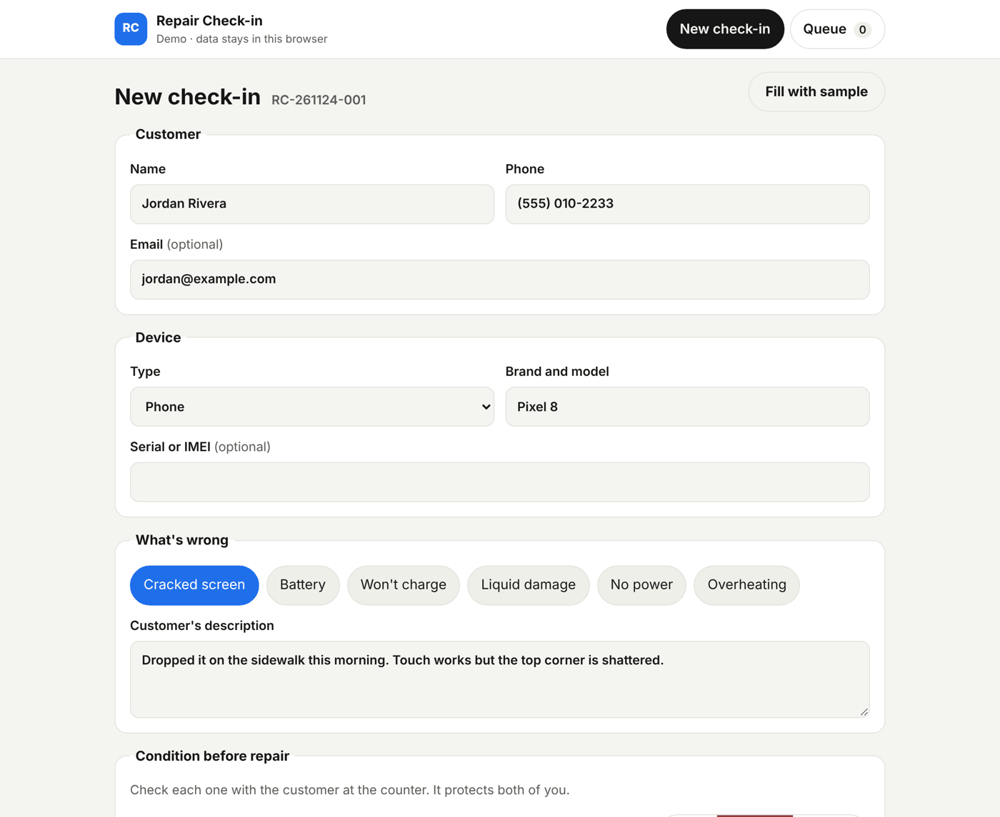
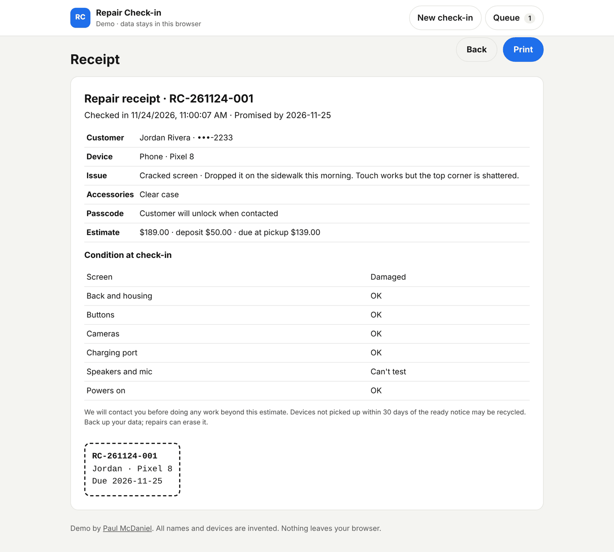

# Repair Check-in

**Live demo:** https://pmacadoo.github.io/repair-checkin-demo/

A check-in screen for a phone and computer repair counter: customer, device, what's wrong, the device's condition, passcode handling and an estimate. Then a printable receipt and a simple repair queue.

I worked a repair counter for years. Most disputes over a repair start with a rushed check-in: "that scratch was already there", "I never agreed to that price", a passcode written on a sticky note. This demo builds the habits that prevent those into the form itself.



## What it does

- **Condition checklist before repair.** Seven items, each marked OK, Damaged or Can't test, with the customer at the counter. You can't check a device in until every item is marked.
- **No passcodes on tickets.** Instead you choose how testing will work. Passcodes never get written down.
- **Clear money.** Estimate, deposit and the balance due at pickup, plus a confirmation box that the customer agreed.
- **Printable receipt and device tag.** The receipt shows the condition table and the terms, and masks the phone number. A dashed tag goes on the device.
- **Queue.** Search by name, device or ticket number, move tickets through statuses, and spot overdue repairs in red.
- **Helpful validation.** One error box lists everything to fix, and each problem field is marked.



## Built with care for

- **Phones and desktops:** a single responsive layout, with nothing scrolling sideways at 375 px.
- **Accessibility:**
  - every control is at least 44 px and has a label
  - toggles announce their state
  - errors are announced
  - follows the system's dark mode and reduced-motion settings
- **Privacy:** no server. Tickets live in your browser's local storage, and all sample data is invented.

## Run it

Open `index.html`, or serve the folder:

```
python3 -m http.server 8000
```

Plain HTML, CSS and JavaScript. No build step and no dependencies.

Related: [ai-helpdesk-triage](https://github.com/pMacadoo/ai-helpdesk-triage) sorts incoming support tickets by category and priority.
